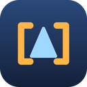

<!--
Copyright (c) 2026 Oleg Chirukhin
Licensed under the Universal Permissive License v 1.0 as shown at https://oss.oracle.com/licenses/upl/
Лицензировано на условиях Universal Permissive License версии 1.0; текст лицензии: https://oss.oracle.com/licenses/upl/
SPDX-License-Identifier: UPL-1.0
-->
# `flow:org.vibevm.codkit/standards` — the default codkit standards {#root}



<status stage="doc" state="done" audience="user"/>

@fact:package-lead A vibe package of kind `flow` carrying the **default codkit standards** — the norms a patch-set repository over a fork follows when codkit maintains it, whatever family that fork belongs to. It is not installed from a registry: codkit itself delivers it. `codkit standards load` copies the package into `vibevm/vibepacks/org.vibevm.codkit/standards/v<version>/` of the product repository and declares it in the product `vibe.toml` as a statically linked dependency; the ordinary `vibe install` materialises it from there. @status:impl/done

@fact:package-contents-lead Edition 1.0.0 — the development edition, mutable in place under that number by the owner ruling of 2026-09-08; it was numbered 0.2.0 until then — ships: @status:impl/done

- @fact:CONTENT-THE-PROTOCOL `vibevm/vibespecs/flows/standards/STANDARDS-PROTOCOL.xml` — what a standard is, how the set is versioned, how a product adopts a standard and records a deviation, who wins on conflict, and where the three licence scopes end. @status:impl/done
- @fact:CONTENT-MINIMAL-INTERVENTION `vibevm/vibespecs/flows/standards/minimal-intervention.xml` — the standard on minimal intervention in the fork: a choice of layer is presented, never made silently; necessity wins over minimality; the three degrees of own-code coupling; one channel per process; two channels per interface string; the seam map per pin; and, since the edition then numbered 0.2.0, the delta as a parallel system in upstream's own style (a patch is a graft, own code mirrors upstream's taxonomy), a feature as one folder behind a flag with layered sources, and the contents of the constant graft set; and, since the in-place extension of 2026-09-07, the own catalogue as a documented system — a router README, layers with a gate, numbered rules, the dependency direction under a service override, the router skill. @status:impl/done
- @fact:CONTENT-SEAM-CATALOGUE The catalogue of upstream seams left this package: seams are facts about one family of upstreams, so it travels as the package of the patch set's project type, `org.vibevm.codkit/seams-<type>`, delivered by the same `codkit standards load`. For the `vscode` type it is `org.vibevm.codkit/seams-vscode`; a type whose upstream has no catalogued seams is delivered none. @status:impl/done
- @fact:CONTENT-THE-BOOT-SNIPPET `vibevm/vibespecs/boot/75-flow-codkit-standards.xml` — the boot snippet: the laws in one line each and the never-do list. @status:impl/done
- @fact:CONTENT-THE-ICON `assets/codkit.svg` (the icon), `assets/codkit-mark.svg` (the mark alone, for light backgrounds), `assets/codkit.png` (512 px) and `assets/codkit-128.png` — the codkit logo: a delta held inside its marker brackets, the patch set inside `codkit:begin`/`codkit:end` (own assets: the SVGs carry their licence header, the PNGs their `.license` sidecars), and `assets/third-party/feather/package.svg` — one third-party icon (Feather Icons, MIT) registered in `REUSE.toml` and listed in `THIRD-PARTY-NOTICES.md`: the package's own worked example of the third-party path the licence check enforces. @status:impl/done

## What changed in the edition, extended in place {#changes}

- @fact:CHANGE-CATALOGUE-MOVED-TO-THE-TYPE The seam catalogue moved out of this package into `org.vibevm.codkit/seams-<type>`, the package of the patch set's project type: the standard is universal, the seams are one family's (PROP-016 `TYPE-AREA-STANDARDS`). Nothing in the standard changed with the move; a product takes it with `codkit standards load --upgrade`, which drops the file here and delivers the type's package beside it. @status:impl/done
- @fact:CHANGE-RENUMBERED-TO-1-0-0 2026-09-08, owner ruling: the edition carries the development version 1.0.0 and is changed in place under that number, the way the package manager's own internal packages live during development. The directory `v0.2.0` moved to `v1.0.0` with not one norm changed; a product takes the move with `codkit standards load --upgrade` and `vibe install --offline --force`. @status:impl/done
- @fact:CHANGE-OWN-CATALOGUE Section 12 of the standard: the own catalogue as a documented system — a router README with a specification change gate, layers as a specification with a gate, numbered behaviour rules, the dependency direction under a service override, menus as named constants, the router skill, and the same shape as upstream's own parallel system; four new conformance checks and two new never-rules. @status:impl/done
- @fact:CHANGE-SEAM-CATALOGUE-0-3 The seam catalogue gained the surface registry, the sanctioned late registrations, part options and the docking of a part; it has since moved out into the package of the project type. @status:impl/done
- @fact:CHANGE-BOOT-LAWS-0-3 Two new laws and one never-rule in the boot snippet. @status:impl/done

## What changed in 0.2.0 at its release {#changes-0-2-0}

- @fact:CHANGE-PARALLEL-SYSTEM Sections 9–11 of the standard: the parallel-system norms, the feature-and-flag norms, the constant graft set; five new conformance checks and three new never-rules. @status:impl/done
- @fact:CHANGE-SEAM-CATALOGUE The seam catalogue as a second file of the edition; it left the edition again when the packages were split per project type. @status:impl/done
- @fact:CHANGE-BOOT-LAWS Three new laws and two never-rules in the boot snippet. @status:impl/done

## How the package reaches a product {#install}

```bash
codkit standards load        # the copy plus the managed block in the product vibe.toml
vibe install --offline       # materialisation into vibevm/vibedeps/ and the boot lane
codkit standards check       # the installed copy and the manifest block are intact
```

@fact:INSTALLED-COPY-IS-CODKIT-OWNED The installed copy belongs to codkit and is never edited. A local deviation from a standard is recorded in the product's own specs as a four-field decision record citing the standard's anchor; `codkit standards load` refuses over an edited copy and writes nothing. @status:impl/done

@fact:UPGRADE-IS-A-NEW-VERSION-DIRECTORY While the edition is mutable it stays `v1.0.0`, and a changed copy is taken with `codkit standards load --upgrade` followed by `vibe install --offline --force`. When the number does change, `codkit standards load` places the new `v<version>` directory beside the old ones and moves the manifest block to the exact new version, leaving every superseded directory in place and listing it; `codkit standards load --upgrade` removes those directories in the same run and names each of them in its plan. @status:impl/done

## Composition {#composition}

- @fact:COMPOSES-CODKIT-LAYER-LADDER The layer ladder and the decision tree come from the installed codkit (PROP-005 §1 and `docs/codkit/protocol/human/03-interventions.md` under the install root); the standard cites them and never restates them. @status:impl/done
- @fact:COMPOSES-DECISION-RECORDS `flow:decision-records` — deviations from a standard and layer choices are recorded with their reasons and a revisit trigger. @status:spec/done
- @fact:COMPOSES-ADDRESSABLE-SPECS `flow:addressable-specs` — a standard's norms are cited by anchor, never by paraphrase. @status:spec/done

## License {#license}

Copyright (c) 2026 Oleg Chirukhin.

This package is licensed under The Universal Permissive License (UPL),
Version 1.0 (SPDX: `UPL-1.0`). The full text is in [LICENSE](LICENSE);
a verbatim copy is also kept in [LICENSES/UPL-1.0.txt](LICENSES/UPL-1.0.txt).

Unless a file states otherwise, every file in this package — specifications,
documentation, and non-code assets — is covered by this license. License
information is recorded per file following the [REUSE](https://reuse.software)
specification: in a comment header at the top of the file, or in an adjacent
`<filename>.license` file for files that cannot carry comments. Where a file's
own notice differs from the above, the file's own notice governs.

Third-party components keep their original copyright notices and
licenses; they are listed in
[THIRD-PARTY-NOTICES.md](THIRD-PARTY-NOTICES.md), and their license texts
are in `LICENSES/`.

The names and logos of this project and of its author are not covered by
this license and may be used only to refer to the project.

When you copy files from this package, including via `codkit standards
load`, keep the copyright notice and the license reference — the file
header or the `.license` file — with every copy. This is the condition
the UPL places on copies.

## Лицензия {#licence-ru}

Copyright (c) 2026 Oleg Chirukhin.

Этот пакет распространяется на условиях The Universal Permissive License
(UPL), версии 1.0 (SPDX: `UPL-1.0`). Полный текст лицензии — в файле
[LICENSE](LICENSE); дословная копия хранится в
[LICENSES/UPL-1.0.txt](LICENSES/UPL-1.0.txt). Текст лицензии существует
только на английском языке; этот раздел — уведомление, и при расхождении
юридически значим английский текст.

Если файл не говорит иного, каждый файл пакета — спецификации, документация и
прочие материалы — покрыт этой лицензией. Лицензионная информация записана в
каждом файле по спецификации [REUSE](https://reuse.software): в заголовке-
комментарии в начале файла либо в соседнем файле `<имя файла>.license` для
файлов, которые не могут нести комментарий. Если собственное уведомление файла
отличается от сказанного здесь, действует уведомление файла.

Сторонние компоненты сохраняют свои уведомления об авторском праве и свои
лицензии; они перечислены в [THIRD-PARTY-NOTICES.md](THIRD-PARTY-NOTICES.md),
тексты лицензий — в `LICENSES/`.

Названия и логотипы проекта и его автора лицензией не покрываются и могут
использоваться только для указания на проект.

Копируя файлы пакета, в том числе командой `codkit standards load`,
сохраняйте уведомление об авторском праве и ссылку на лицензию — заголовок
файла или файл `.license` — в каждой копии. Это условие, которое UPL ставит
на копии.

@fact:license-line UPL-1.0; the English notice above governs, the Russian one is a notice. @status:impl/done
